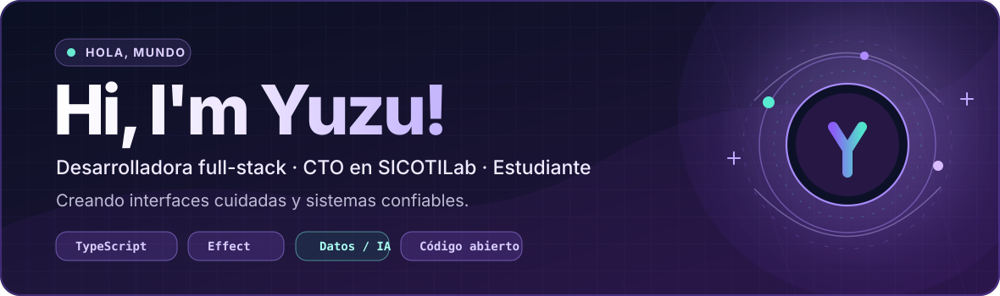
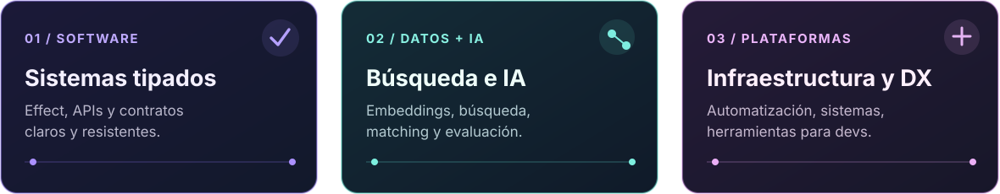
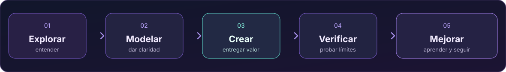
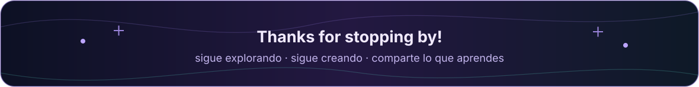

<!-- Yuzu · personal GitHub profile README | icons display names on hover via title attributes -->

  
  

  

  

  

    
    
    
  

## Sobre mí (˶ᵔ ᵕ ᵔ˶)

¡Hola! Soy **Yuzu**, desarrolladora **full-stack** y **CTO de SICOTILab**. Me encanta convertir ideas en productos útiles, desde la interfaz hasta los servicios, los datos y la infraestructura que los sostienen.

Actualmente me enfoco en **TypeScript + Effect**, el desarrollo de interfaces cuidadas y los **sistemas de datos con inteligencia artificial**. Me gusta aprender y ayudar a otras personas, aunque sea un poquito tímida. ♡

## Lo que me gusta construir

  

## Tecnologías y herramientas

### Lenguajes

   &ensp;
   &ensp;
   &ensp;
   &ensp;

### Frontend e interfaces

   &ensp;
   &ensp;
   &ensp;
   &ensp;
   &ensp;
   &ensp;
   &ensp;
   &ensp;
   &ensp;

### Backend y APIs

   &ensp;
   &ensp;
   &ensp;
   &ensp;
   &ensp;
   &ensp;
   &ensp;
   &ensp;

### Bases de datos, búsqueda y almacenamiento

   &ensp;
   &ensp;
   &ensp;
   &ensp;
   &ensp;
   &ensp;
   &ensp;
   &ensp;

### Infraestructura y herramientas de desarrollo

   &ensp;
   &ensp;
   &ensp;
   &ensp;
   &ensp;
   &ensp;
   &ensp;
   &ensp;
   &ensp;
   &ensp;

## Cómo trabajo

Me gusta entender el *porqué* antes de decidir el *cómo*. Después construyo en pasos pequeños, pruebo los casos límite y sigo mejorando lo que realmente importa.

  

## Dónde encontrarme

  
  
  
  
  
  

  

