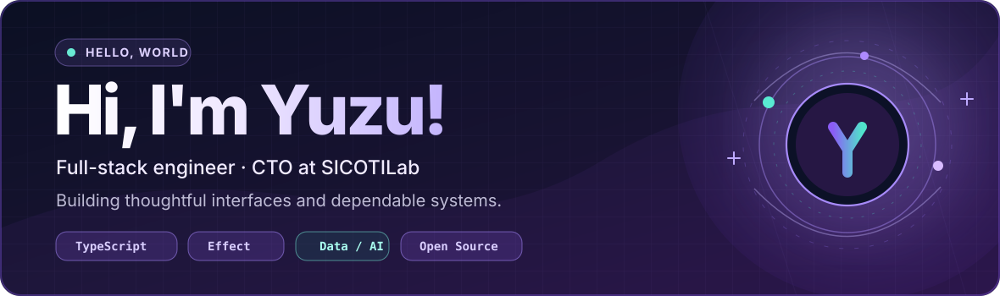
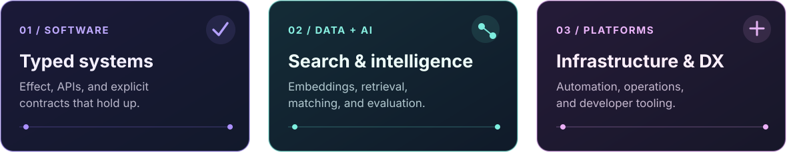
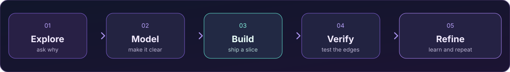
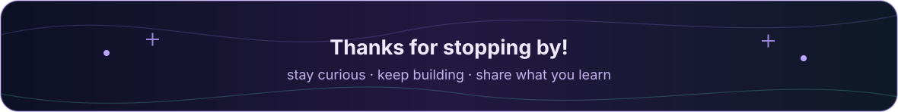

<!-- Yuzu · personal GitHub profile README | icons display names on hover via title attributes -->

  
  

  

  

  

    
    &ensp;
    
    &ensp;
    
  

## About me (˶ᵔ ᵕ ᵔ˶)

Hi! I'm **Yuzu**, a full-stack engineer and the **CTO at SICOTILab**. I love turning ideas into things people can use, from the interface all the way down to the services, data, and infrastructure behind it.

These days, I'm especially into **TypeScript + Effect**, thoughtful frontend engineering, and **AI-powered data systems**. I love learning and helping others, even if I'm a little shy. ♡

## Things I love building

  

## Technologies & tools

### Languages

   &ensp;
   &ensp;
   &ensp;
  <a href="https://www.rust-lang.org" title="Rust"><picture><source media="(prefers-color-scheme: dark)" srcset="https://cdn.simpleicons.org/rust/FFFFFF" /><source media="(prefers-color-scheme: light)" srcset="https://cdn.simpleicons.org/rust/000000" /></picture></a> &ensp;
   &ensp;

### Frontend & UI

   &ensp;
   &ensp;
   &ensp;
  <a href="https://nextjs.org" title="Next.js"><picture><source media="(prefers-color-scheme: dark)" srcset="https://cdn.simpleicons.org/nextdotjs/FFFFFF" /><source media="(prefers-color-scheme: light)" srcset="https://cdn.simpleicons.org/nextdotjs/000000" /></picture></a> &ensp;
   &ensp;
  <a href="https://ui.shadcn.com" title="shadcn/ui"><picture><source media="(prefers-color-scheme: dark)" srcset="https://cdn.simpleicons.org/shadcnui/FFFFFF" /><source media="(prefers-color-scheme: light)" srcset="https://cdn.simpleicons.org/shadcnui/000000" /></picture></a> &ensp;
  <a href="https://base-ui.com" title="Base UI"><picture><source media="(prefers-color-scheme: dark)" srcset="https://cdn.simpleicons.org/baseui" /><source media="(prefers-color-scheme: light)" srcset="https://cdn.simpleicons.org/baseui/000000" /></picture></a> &ensp;
   &ensp;
   &ensp;

### Backend & APIs

  <a href="https://effect.website" title="Effect"><picture><source media="(prefers-color-scheme: dark)" srcset="https://cdn.simpleicons.org/effect" /><source media="(prefers-color-scheme: light)" srcset="https://cdn.simpleicons.org/effect/000000" /></picture></a> &ensp;
   &ensp;
   &ensp;
   &ensp;
  <a href="https://www.better-auth.com" title="Better Auth"><picture><source media="(prefers-color-scheme: dark)" srcset="https://cdn.simpleicons.org/betterauth" /><source media="(prefers-color-scheme: light)" srcset="https://cdn.simpleicons.org/betterauth/000000" /></picture></a> &ensp;
   &ensp;
   &ensp;
   &ensp;

### Databases, search & storage

   &ensp;
   &ensp;
   &ensp;
   &ensp;
   &ensp;
   &ensp;
   &ensp;
   &ensp;

### Infrastructure & developer tooling

   &ensp;
   &ensp;
   &ensp;
   &ensp;
   &ensp;
   &ensp;
   &ensp;
  <a href="https://vercel.com" title="Vercel"><picture><source media="(prefers-color-scheme: dark)" srcset="https://cdn.simpleicons.org/vercel/FFFFFF" /><source media="(prefers-color-scheme: light)" srcset="https://cdn.simpleicons.org/vercel/000000" /></picture></a> &ensp;
   &ensp;
   &ensp;

## How I work

I like to understand the *why* before writing the *how*. Then I build in small steps, test the edge cases, and keep improving what matters.

  

## Find me around the web

  &ensp;
  &ensp;
  

  &ensp;
  &ensp;
  

  

